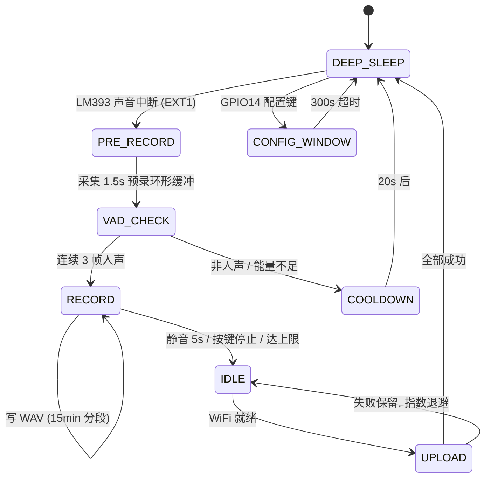

# 技术实现与问题修复

> 用途：给视频提供「硬核但听得懂」的技术素材，以及给 fork 的人一份避坑地图。
> 细节以 `docs/handover-2026-10-31.md`、`docs/progress-2026-10-31.md` 为准，本文是提炼版。

---

## 1. 系统结构

```
┌──────────────────────────── 设备端（ESP32-S3）────────────────────────────┐
│                                                                            │
│  LM393 ──GPIO15(EXT1)──┐                                                   │
│  GPIO14 配置键 ────────┤→ 唤醒/复位                                        │
│                        ▼                                                   │
│   ┌──────────┐   I2S    ┌──────────┐   SPI    ┌──────────┐                │
│   │ INMP441  │─────────▶│  ESP32   │─────────▶│ MicroSD  │                │
│   │ 16k/16b  │  GPIO4-6 │  S3 R8   │ GPIO10-13│ 32GB     │                │
│   └──────────┘          │          │          └──────────┘                │
│                         │  VAD     │                                       │
│                         │  环形缓冲 │──WiFi──▶ HTTP multipart ──┐           │
│                         │  网页服务 │                          │           │
│                         └──────────┘                          │           │
└───────────────────────────────────────────────────────────────┼───────────┘
                                                                ▼
                                              ┌─────────────────────────────┐
                                              │ 后端（自建，FastAPI）        │
                                              │ 落盘 + SQLite + 去重         │
                                              │ 后续：转写 → 日记 → 检索      │
                                              └─────────────────────────────┘
```

设计原则（也是这个项目和「录音笔」的区别）：

1. **设备端只做采集和搬运**，不做转写，省电省算力。
2. **录音时关 WiFi**，避免射频噪声污染麦克风。
3. **上传成功前绝不删文件**，宁可占空间也不丢数据。
4. **事件驱动**，不是 24 小时连续录，功耗和隐私都更可控。

---

## 2. 级联唤醒状态机



对应代码：`firmware/main/app_main.c`、`recorder.c`、`vad.c`。

---

## 3. 模块与职责

| 文件 | 职责 | 关键实现 |
|---|---|---|
| `app_main.c` | 状态机、配置窗口、睡眠决策 | 先开窗口再连 WiFi；断网每 10s 重连；EXT1 唤醒源区分 |
| `recorder.c` | 预录 → VAD → 分段写 WAV | 1.5s 环形缓冲；静音 5s 收尾；JSON 元数据 |
| `vad.c` | 轻量 VAD（可在 PC 单测） | 最小统计量噪声底 + 能量门限 + 过零率；连续 3 帧确认 |
| `mic_i2s.c` | INMP441 采集 | 16k/16bit/mono，DC blocker，+18dB |
| `wav_writer.c` | WAV 写入 / 头回填 | 44 字节标准头；关闭时回填长度并校验 |
| `sd_store.c` | SD 挂载 / 格式化 / 列表 / 清理 | 5V 供电；64KB 簇；挂载失败可自动格式化 |
| `uploader.c` | multipart 上传 + 退避 | 2/4/8/16/32s；`.up` 标记；服务端去重 |
| `net_wifi.c` | WiFi STA | 录音时关闭，上传前重连 |
| `time_sync.c` | NTP + 断电恢复 + 可信度 | NVS `last_epoch`；60s 重试；`time_source` |
| `web_config.c` | 内置网页 + REST | 24 个 URI handler；20+ 参数热改 |
| `app_config.c` | NVS 配置 | 键值持久化，出厂重置 |
| `app_status.c` | 运行状态快照 | 电平、时间、文件数、待传数 |
| `led_button.c` | 状态 LED + 双按键 | GPIO41 启停/补传，GPIO14 配置；板载 LED 已停用 |

---

## 4. 踩坑与修复（视频重点素材）

> 每个坑都按「现象 → 根因 → 修复 → 教训」写。视频里挑 3 个讲就够，别全塞。

### 4.1 坑 1：SD 卡「坏块」——其实是供电

| 项 | 内容 |
|---|---|
| **现象** | 32GB TF 卡随机 CRC 报错、写失败；断电 5 秒能临时恢复，几分钟后复发；先怀疑卡坏了 |
| **排查** | 固件加原始块读自检接口 `/api/sdtest`，错误块位置会漂移（29895 → 7547），不像真坏块 |
| **根因** | SD 模块板载 3.3V LDO，**VCC 接 3V3 时压差不足**，卡供电不稳 |
| **修复** | **VCC 改接 5V**；固件保留 64KB 簇、`sd_store_recover()`、头校验重试、坏段自动删除 |
| **结果** | 同一张卡 0–100MB 扫描 **0 错误**，格式化 / 60s 录音 / 连续 10 次录音 / 上传全通过 |
| **教训** | 「坏块」先量电压。模块标 3.3V 不代表 3.3V 供电能稳 |

> 视频金句：**「查了两天的坏块，最后是一根线接错了电压。」**

### 4.2 坑 2：断电重启后，录音文件全都没时间

| 项 | 内容 |
|---|---|
| **现象** | 设备没有电池 RTC，断电/复位后系统时间回到 1970；文件名退化成 `mic1_session-01xx_part1.wav` |
| **根因** | 旧固件只在开机连上 WiFi 后做**一次** NTP；断网时这次也失败，之后不再重试 |
| **修复** | ① NTP 成功/深睡前/每 10 分钟把 epoch 写 NVS；② 开机若时间 < 2024 就从 NVS `settimeofday()` 恢复；③ 文件名改用 `time_sync_valid()`，近似时间也带日期；④ 未校准时每 60s 重试；⑤ 网页显示 `NTP / RTC / 近似 / 不可信` |
| **结果** | 冷启动 `22:22:40` 恢复 → `22:22:49` NTP 校正；文件名 `mic1_2026-10-31_22-23-08_part1.wav`；后端 `time_trusted=1` |
| **局限** | 「近似时间」的误差 = 断电时长；只解决文件名有日期，不能凭空恢复断电期间的准确时刻 |
| **教训** | 没有 RTC 的设备，「时间」是一项需要持久化的状态，不是一次 NTP 调用 |

> 视频金句：**「它没有电池时钟，所以我让它把时间记在 Flash 里。」**

### 4.3 坑 3（BUG-1）：深睡后板载 LED 一直亮

| 项 | 内容 |
|---|---|
| **现象** | 进入深睡，板载 LED 仍然亮；唤醒后才灭。用户三次目视确认 |
| **尝试** | 三种软件方案全部失败：① 活动输出 + `gpio_hold_en` + `deep_sleep_hold`；② `SLP_SEL` + 睡眠输出高 + 上拉；③ `SLP_SEL` + 睡眠输入 + 上拉 |
| **根因** | **GPIO48 不是 RTC GPIO**，深睡时数字域掉电；引脚既不能 hold 驱动，也拿不到常电域上拉。LED 阳极接 3.3V，引脚悬空漏电就点亮 |
| **修复** | 软件无法根治 → **停用板载 LED**（固件不再写 GPIO48，醒着保持灭）；根治方案：GPIO48 ↔ 3V3 加 **10kΩ 上拉**（深睡高电平灭，录音时强驱动低点亮，只多耗 ~0.33mA） |
| **当前状态** | 深睡时仍可能亮，**不代表在录音**；外接 GPIO47 状态灯已设计但未接线 |
| **教训** | 深睡 GPIO 要选 **RTC 域** 引脚；LED 极性设计要默认「灭」 |

> 视频金句：**「软件关了三次都没关掉，因为问题根本不在软件。」**

### 4.4 坑 4：三连 RST 进不了配置模式

| 项 | 内容 |
|---|---|
| **现象** | 按三次复位，板子确实重启了，但 WiFi 没开、网页进不去，直接又睡了 |
| **根因** | ① 旧逻辑只在 **WiFi 连上之后**才开配置窗口；② 三连复位靠 NVS 计数 + 15s 窗口，节奏稍慢就被清掉 |
| **修复** | 删掉整套计数逻辑，改用 **GPIO14（RTC 域）配置键**：深睡按下 → EXT1 唤醒 → 300s 窗口；醒着短按延长、长按补传；窗口**先开再连 WiFi**，断网也保持唤醒并每 10s 重连 |
| **结果** | 日志 `mask=0x4000, 配置键=1`；用户实测网页可进；保存配置自动延长到 300s |
| **教训** | 用「重启次数」当隐藏入口不可靠；一个专用按键 + 明确超时窗口更稳 |

### 4.5 其它已修问题（可作为 B-roll 字幕）

| 问题 | 根因 | 修复 |
|---|---|---|
| 第 17 个网页接口静默失效 | ESP-IDF httpd 默认 16 个 URI handler，超出只打日志不报错 | 上限 16 → 24 |
| 静音停录误判 | 单帧人声就刷新「最后说话时刻」 | 改为**连续 3 帧**人声才刷新 |
| WAV 头校验误判 / 唤醒后不录音 | 头回填与状态机时序 | 修回填逻辑 + 唤醒后重置状态 |
| 上传日志误报 duplicate | 服务端去重返回被当成失败 | 区分 `stored` / `duplicate` |
| VAD 太灵敏 | 本房间噪声底低，8dB 阈值频繁触发 | 默认阈值调到 12dB |
| 按键抖动 | 杜邦线接触弹跳，40ms 误触 | 已记录，建议 10–100ms 软件消抖（未做） |
| LM393 灵敏度临界 | 电位器未标定，连拍 10 下触发约 4 次 | 建议 VCC 改 5V 后重标（未做） |

---

## 5. 已知限制（诚实清单）

| 限制 | 影响 | 计划 |
|---|---|---|
| 没有 AP 配网 | WiFi 密码填错就进不去网页 | 阶段 3 做设备热点兜底 |
| 深睡电流未实测 | 续航只是估算 | 阶段 3 万用表实测 |
| VAD 1 小时误触发率未测 | 不知道一天会误录几次 | 静置 1 小时统计 |
| 没有录音指示灯 | 隐私指示缺失 | 接 GPIO47 或修好板载 LED |
| 后端只有落盘 | 没有转写/日记 | 阶段 2 |
| 仍是模块 + 杜邦线 | 不是成品形态 | 阶段 3 画板 + 外壳 |

---

## 6. 验证证据（可直接截图进视频）

```
W (950)  time: 从 NVS 恢复时间 (近似, 联网后 NTP 校正): 2026-10-31 22:22:40
W (5524) time: NTP 对时成功: 2026-10-31 22:22:49
I (929)  main: 复位原因: 8, 深睡唤醒: EXT1 (mask=0x4000, 声音=0, 配置键=1)
I (24447) wav: 开始写: /sdcard/mic1_2026-10-31_22-23-08_part1.wav (16000 Hz)
I (33265) upload: 上传成功: ... -> HTTP 200 (stored)
I (265817) upload: 上传结束: 成功 1, 失败 0, 重复 0
```

- 串口日志：`logs/serial-r3.log`（按键）、`serial-r4.log`（GPIO14 唤醒）、`serial-final.log`（时间恢复）
- 后端：`http://192.168.5.36:8000/api/uploads?limit=500`（121 条）
- 录音样本：`artifacts/rec60.wav`、`artifacts/wake_e2e.wav`

> 截图建议：终端字号调大，只截关键 6~8 行，别整屏糊上去。
